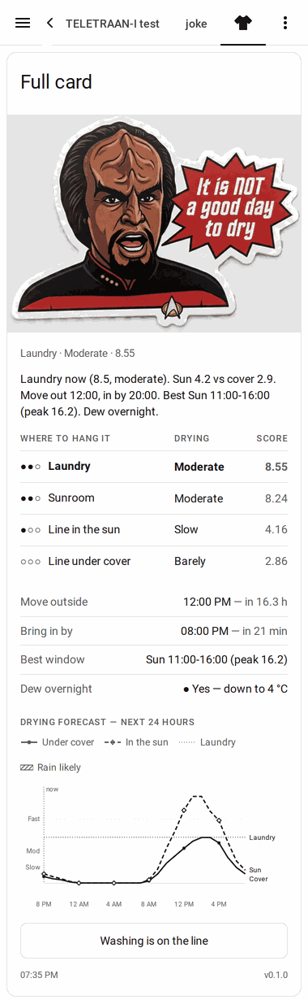

# Laundry Weather

**Where should I hang the washing?**

<br clear="left">

[](https://hacs.xyz)
[](https://github.com/loryanstrant/HA-Laundry-Weather/actions/workflows/validate.yaml)
[](https://github.com/loryanstrant/HA-Laundry-Weather/releases)
[](LICENSE)

Laundry Weather scores every place you could hang a load — each indoor room, the line under
cover, and the same line pulled out into the sun — and tells you which one wins right now,
when to move it outside, and when to bring it in.

It comes with a Lovelace card that shows the answer, and charts how the next 24 hours are
going to go.


<p align="center">
  
</p>

<p align="center"><em>The same card on a phone — the layout is checked at 380px.</em></p>

---

## What it tells you

- **Where to hang it now**, ranked, with a plain-English drying rate for each spot.
- **When to move it outside**, or that today it is simply not worth the trip.
- **When to bring it in** — always, whether or not going outside was ever worthwhile.
- **The best stretch** of the next two days.
- **Whether dew will re-wet it** if you leave it out overnight.
- **A forecast chart** of how well each spot will dry, hour by hour.

---

## Installing

**Via HACS** (recommended)

1. HACS → ⋮ → *Custom repositories* → add `https://github.com/loryanstrant/HA-Laundry-Weather`
   as an **Integration**.
2. Install *Laundry Weather*, then restart Home Assistant.
3. *Settings → Devices & Services → Add Integration → Laundry Weather*.

**By hand**

Copy `custom_components/laundry_weather/` into your `config/custom_components/` folder and
restart.

The card is bundled — it installs and registers itself with Lovelace, so there is no second
thing to install and no resource to add by hand. (If your dashboards are in YAML mode, the log
prints the exact two lines to paste.)

---

## Setting it up

A five-step form, with an explanation on every field. It only ever **reads** your sensors;
nothing on your system is changed.

| Step | What it asks for |
|---|---|
| **Laundry Weather** | A name, and a weather entity that provides an **hourly** forecast |
| **Outside** | Outdoor temperature and humidity (required), dew point, wind speed, wind gusts |
| **Sun and sky** | A solar radiation sensor, sun elevation, sunset — all optional |
| **Rain** | A rain sensor and what it says when dry, plus rainfall rate — both optional |
| **A drying room** | Name, temperature, humidity — then loop to add more |

**Add every room you would actually hang washing in.** More than one is the normal case, not
an edge case: a sunroom and a laundry regularly trade places through the day, and being told
which one is winning right now is the whole point.

Only outdoor temperature, outdoor humidity and the weather entity are required. Everything
else degrades gracefully — see [what else is worth having](#what-else-is-worth-having-installed).

### Settings you can change later

*Settings → Devices & Services → Laundry Weather → Configure* opens a menu:

- **Fine-tune the scoring** — the sun coefficient, the margin outside must beat inside by, the
  bring-in cutoff, the band thresholds, and how the forecast judges sunshine.
- **Card and display** — Klingon headings, the mascot, how many hours the chart shows, and
  whether to reuse an existing "washing is out" helper you already have.
- **Add** or **remove a drying room**.
- **Change the sensors**.

---

<details>
<summary><b>How the score is worked out — vapour pressure deficit, wind, sun, and why bands not hours</b></summary>

### How the score is worked out

The honest version, because the number on the card is meaningless if you do not know what it
is measuring.

### Drying is about how thirsty the air is

Washing dries when water evaporates off it, and water evaporates into air that has room for
more. That capacity is **vapour pressure deficit** — the gap between how much moisture the air
*could* hold at its current temperature and how much it is actually holding.

It is neither temperature nor humidity alone, and that has a consequence most people find
surprising: **a cold clear day frequently beats a warm humid one.** 10 °C at 30% humidity has
substantially more drying power than 25 °C at 85%. The card will tell you that, and it is
right.

VPD is computed with the Magnus formula, in hectopascals:

```
vpd = 6.112 × e^(17.67·t / (t + 243.5)) × (1 − rh/100)
```

Checked against a weather station that computes its own VPD in firmware, this agrees to
**0.0085 hPa** — about 0.17%, and two orders of magnitude smaller than the gap between one
drying band and the next. It cannot change an answer.

Every spot is scored with the same formula, so comparing a room against a line is meaningful.

### Wind helps, up to a point

Moving air carries away the humid layer that forms against wet fabric. It helps a lot at
first, then stops helping — past about 20 km/h you are mostly just watching your pegs. So wind
is normalised against that ceiling:

```
wn = min(wind_kmh, 20) / 20
```

and applied differently depending on where the washing is:

| Spot | Factor | Why |
|---|---|---|
| **Indoor room** | none | Indoor air is still. The room score is plain VPD. |
| **Line under cover** | `0.55 + 0.45 × wn` | A roof kills most of the breeze |
| **Line in the sun** | `0.8 + 0.6 × wn` | Fully exposed |

### The sun

Sunlight warms the fabric directly, which is worth far more than the air temperature suggests.
Two things have to be separated to use it, though: **is it dim because it is cloudy, or dim
because it is nearly evening?** Those mean very different things for drying.

So the measured irradiance is compared against the clear-sky value for the sun's *current*
height:

```
clear_sky   = 1050 × sin(elevation)
sky_fraction = clamp(measured_solar / clear_sky, 0, 1)
```

That gives "what fraction of the available sun is actually getting through". It is then gated
by elevation, because low sun is bright but glancing and warms the washing much less than the
irradiance figure implies:

```
gate       = clamp((elevation − 10) / 30, 0, 1)     # ramps in between 10° and 40°
sun_factor = 1 + 1.2 × sky_fraction × gate
```

At the default coefficient of 1.2, full midday sun makes the exposed line dry a little over
twice as fast as the same air under cover. **That 1.2 is deliberately conservative and
untuned** — it is the number to adjust once you have watched a few real loads dry, which is
why it is in the options rather than buried in the code.

And if it is raining on the line, the exposed score is zero regardless of everything above.

### The forecast

Future hours have no irradiance reading, so sunshine has to be estimated from whatever the
provider does give:

| Model | Used when | Formula |
|---|---|---|
| **UV index** | The provider supplies one (BOM, OpenWeatherMap) | `1 + 0.6 × min(uv, 5) / 5` |
| **Cloud cover** | It does not (Met.no) | `1 + 1.2 × (1 − cloud/100) × gate` |
| **Time of day** | Neither is available | `1 + 1.2 × gate` |

Left on *Automatic*, it picks whichever your forecast can actually support. This fallback is
not a nicety: **Met.no returns no UV index at all**, so a UV-only model would sit at 1.0
forever and the "move it outside at" line would never once fire.

A forecast hour counts as wet at ≥50% chance of rain or ≥0.5 mm. A wet hour zeroes the exposed
line but **not** the covered one — that is what a roof is for, and it is why "move it under
cover" stays useful advice when rain is coming.

### Bands, not hours

Scores are reported as **Fast / Moderate / Slow / Barely**, at 12, 6 and 3 hPa.

It would be easy to print "dry in about 2 hours" instead, and it would be more satisfying to
read. It would also be made up: turning VPD into a time needs a calibration constant that
depends on fabric weight, garment type and how heavily the line is loaded, and nobody has
measured those. An hours figure would look more useful and be less true, so it is not offered
until there is real data to calibrate against.

### Choosing a spot, and the timings

**The recommendation** picks the highest-scoring spot, except that outside has to beat your
best indoor room by **15%** before it wins. Without that margin the answer flip-flops between
"Sunroom" and "Line in the sun" every few minutes as cloud crosses the sun.

**Move outside at** is the first upcoming hour where the exposed line beats your best room by
that same margin, capped at sunset. If no hour qualifies, it says so — "not worth it today" is
a real answer, not a missing one.

**Bring in by** only answers when there is a drying day left to answer for. After sunset, in
rain, or when the score is already below the cutoff, the card says **"Not drying now"** rather
than a countdown — an earlier version scanned overnight hours and cheerfully offered
"bring it in by 11pm, in 52 minutes" four hours after dark, which read as a grace period that
did not exist. The `drying_now` attribute on the recommendation sensor exposes the same signal
if you want to automate on it.

While drying *is* happening, it is the first upcoming hour where *both* outdoor positions drop
below the cutoff, or sunset, whichever comes first. It uses whichever position is better because the
line is movable: as long as either is still drying, there is a reason to leave it out.

**It is computed with no reference to "move outside at", deliberately.** In the version this
integration grew out of, the two were coupled — and on days when going outside was never
worthwhile, the bring-in time was wiped along with it. That is exactly the day it matters
most, with a load already on the line and rain coming. The function that computes it does not
take the other time as an argument, so the two cannot be re-coupled by accident.

**Best window** is the peak hour expanded outwards while neighbouring hours still score at
least 60% of the peak, stopping at the first dip — so a good afternoon and a good tomorrow
morning read as two windows rather than one long one.

**Dew overnight** compares the current dew point against the coldest forecast hour tonight
(18:00–08:00, within the next 20 hours). If the air cools below its own dew point, moisture
condenses back onto the washing and a load that was dry at dusk is damp by morning.

### Solar readings are smoothed

Irradiance is the noisiest input in the model, and it multiplies the sun factor — so raw, it
makes the recommendation flap. On one ordinary afternoon a reading was observed going
528 → 564 → 426 → 150 W/m² as cloud scudded over.

Laundry Weather applies a ten-minute smoothing average of its own. If you already point it at
a Statistics helper that averages for you, tick *"this sensor is already averaged"* and it
leaves it alone.

</details>

---

<details>
<summary><b>What else is worth having installed — weather station, room sensors, sun, forecast, rain</b></summary>

### What else is worth having installed

Laundry Weather reads sensors you choose, so it works with whatever you have. This is what
each addition actually buys you, and what happens without it.

### A local weather station — the biggest single win

**Ecowitt, Davis, WeatherFlow, Netatmo, or anything reporting to Home Assistant.**

A forecast provider tells you about your region. A weather station in your garden tells you
about *your garden* — and for drying, the difference is large. It gives you live **solar
radiation**, which is the only way to know how much sun is really reaching the line right now,
and true local **humidity**, which varies far more over a few kilometres than temperature does.

*Without one:* rooms and the covered line still score correctly from any outdoor temperature
and humidity sensor. The exposed-line score falls back to the elevation gate alone, so it will
under-promise on bright days.

### Room temperature and humidity sensors

**Zigbee, Z-Wave, Bluetooth, ESPHome — anything reporting both.** One per room you would hang
washing in.

*Without them:* no indoor spots are scored, and the card compares only the two line positions.
Both readings are needed per room; a room with only a thermometer is skipped rather than
guessed at.

### Sun, or Sun2

**Sun** is built into Home Assistant and is enough. [Sun2](https://github.com/pnbruckner/ha-sun2)
gives finer-grained elevation and sunset sensors if you would rather point at those explicitly.

*Without either:* Home Assistant's own sun tracker is used automatically. There is genuinely
no reason to change this unless you have a specific need.

### An hourly forecast provider

**Bureau of Meteorology** (Australia), **Met.no** (free, worldwide, built in),
**OpenWeatherMap**, or any integration exposing an hourly forecast.

This drives every forward-looking part of the card: move-outside-at, bring-in-by, the best
window, the dew check and the whole chart.

- **BOM** and **OpenWeatherMap** provide a UV index, which is the best sunshine signal.
- **Met.no** provides no UV index — Laundry Weather detects this and uses cloud cover instead.
  It works; it is a little coarser.

*Without an hourly forecast:* the current scores and the recommendation still work perfectly.
The timing lines stay empty and the chart shows an explanatory empty state. A **daily-only**
forecast is not enough — it must be hourly.

### A Statistics helper for solar radiation

Optional. Laundry Weather smooths solar readings itself, so this is only worth doing if you
want a specific averaging window or already have one for other purposes. Tick *"this sensor is
already averaged"* so it does not get smoothed twice.

### Rain detection

A rain sensor, a rainfall-rate sensor, or both. Both are optional and act as independent
checks on each other.

*Without either:* it assumes dry. The forecast still warns you about rain that is coming; it
just will not know about rain that has already started.

</details>

---

<details>
<summary><b>Entities — what the integration creates</b></summary>

### Entities

One device, with:

| Entity | What it is |
|---|---|
| `sensor.<name>_recommendation` | Where to hang it. Carries the card's whole payload in its attributes |
| `sensor.<name>_advice` | One plain-English sentence |
| `sensor.<name>_<room>_drying_score` | One per configured room, in hPa |
| `sensor.<name>_line_under_cover_score` | The covered line |
| `sensor.<name>_line_in_the_sun_score` | The same line, out in the open |
| `sensor.<name>_bring_in_by` | Timestamp. Always has a value |
| `sensor.<name>_move_outside_at` | Timestamp, or nothing when it is not worth it |
| `sensor.<name>_best_window` | e.g. `Sun 11:00-16:00 (peak 16.2)` |
| `binary_sensor.<name>_good_drying_day` | Drives the card's headline |
| `binary_sensor.<name>_overnight_dew` | Will dew re-wet it tonight |
| `binary_sensor.<name>_currently_raining` | Is it raining on the line now |
| `switch.<name>_washing_on_the_line` | Tell it there is a load out; changes what the advice leads with |

Two services: `laundry_weather.refresh` and `laundry_weather.set_washing_out`.

</details>

---

<details>
<summary><b>The card — configuration options and how to read the chart</b></summary>

### The card

```yaml
type: custom:laundry-weather-card
entity: sensor.laundry_weather_recommendation
```

That is the whole minimum configuration — everything else is read from that one entity's
attributes, which means the card survives you renaming or adding a room. There is a visual
editor, so you never have to write this by hand.

| Option | Default | What it does |
|---|---|---|
| `entity` | *required* | The recommendation sensor |
| `title` | none | A heading above the card |
| `show_mascot` | `true` | The banner picture |
| `show_spots` | `true` | The ranked table |
| `show_timing` | `true` | Move out / bring in / best window / dew |
| `show_forecast` | `true` | The chart |
| `show_switch` | `true` | The "washing is on the line" button |
| `forecast_hours` | `24` | How far ahead the chart looks (6–48) |
| `klingon` | follows the integration | Klingon headings |
| `time_format` | `auto` | `auto` follows Home Assistant, or force `12` / `24` |
| `compact` | `false` | Headline and timings only |
| `image_good` / `image_bad` | bundled | Your own pictures instead |

### Reading the chart

Three lines, told apart by **shape rather than colour**: the covered line is solid with round
markers, the sunny line is dashed with diamonds, and your best indoor room is a flat dotted
reference so you can see when outside finally overtakes inside. Each is labelled at its right
end. Hatching below the axis marks hours when rain is likely, and the band thresholds are
named down the left-hand side.

**Nothing on this card uses colour to mean anything.** Drying rates are shown as a fill meter
plus the word — `●●●` Fast, `●●○` Moderate, `●○○` Slow, `○○○` Barely — so the card reads
correctly for colour-blind users and in every theme.

</details>

---

<details>
<summary><b>About the Klingon — and why it is not canon</b></summary>

### About the Klingon

The Klingon toggle swaps the headline to `QaDmoHlu'meH QaQ jajvam` on a good drying day and
`QaDmoHlu'meH QaQbe' jajvam` on a bad one, modelled on the canonical proverb *Heghlu'meH QaQ
jajvam* — "today is a good day to die".

**These phrases are constructed, not canon.** They are built from `QaD` ("be dry") + `-moH`
(causative) + `-lu'` (indefinite subject) + `-meH` (purpose) + `-be'` (negation), and they have
not been checked by the Klingon Language Institute or anyone else qualified. Please do not
quote them as authoritative Klingon.

The bundled Klingon banners render them in **pIqaD**, the Klingon script. One caveat worth
being straight about: the face used maps upper and lower case to the same glyph, and Klingon
orthography treats `Q`/`q`, `D`/`d`, `H`/`h`, `I`/`i` and `S`/`s` as *different letters* — the
very letters `QaDmoHlu'meH` depends on. So the script is decoratively right and
orthographically approximate. It looks the part; do not use it to learn pIqaD.

It is a string swap, not translation. Entity states stay in English whatever you set, so
nothing you have automated breaks when you flip it.

</details>

---

## Credits and licensing

Code is MIT licensed — see [LICENSE](LICENSE).

The bundled banner artwork is a third-party Star Trek sticker design, included at the
repository owner's request for personal use. It is not covered by the MIT licence above, and
Star Trek and its characters remain the property of their respective rights holders. Use
`image_good:` and `image_bad:` to substitute your own pictures.

Issues and pull requests are welcome on
[GitHub](https://github.com/loryanstrant/HA-Laundry-Weather/issues).

For the full derivation of the model, including the reasoning behind each constant, see
[docs/the-drying-model.md](docs/the-drying-model.md).
